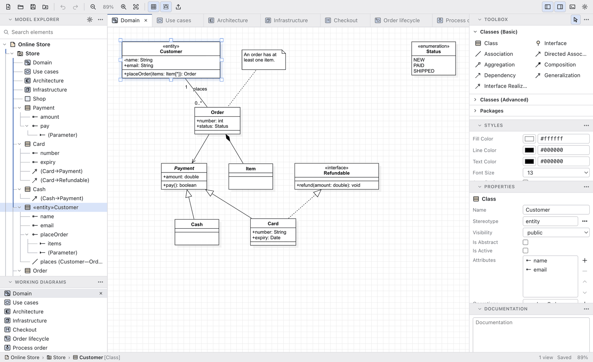
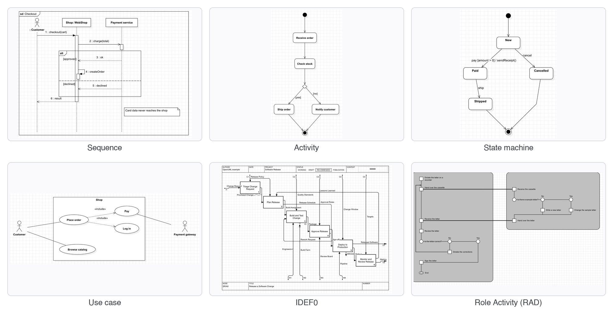
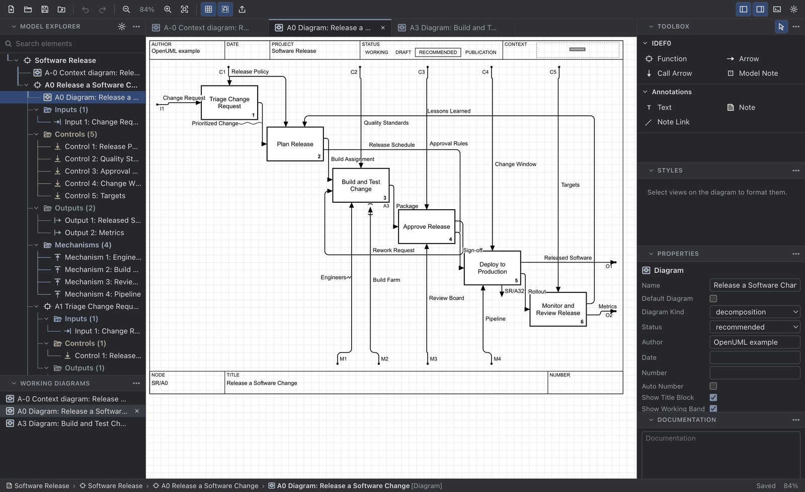

<p align="center"></p>

<h1 align="center">OpenUML</h1>

<p align="center">
  The free, open-source alternative to StarUML, for macOS, Windows and Linux.<br>
  15 UML diagram types, IDEF0 and Role Activity Diagrams, in <code>.mdj</code> files.
</p>

<p align="center">
  <a href="https://github.com/AHHMED-J/OpenUML/releases/latest"><b>⬇ Download the latest version</b></a>
  &nbsp;·&nbsp; <a href="#download">Which file?</a>
  &nbsp;·&nbsp; <a href="#development">Development</a>
</p>



## What you can draw



```
UML structure   class · object · package · component · deployment · composite structure · profile
UML behavior    use case · activity · state machine · sequence · communication · timing
                interaction overview · information flow
Processes       IDEF0 · Role Activity Diagrams (RAD)
```

## Highlights

| | |
| --- | --- |
| 🗂 **Model Explorer** | project tree, search, drag to re-parent, double-click to open |
| ✏️ **Editing** | live preview, snap to grid, quick-edit syntax (`-total : Money = 0`), copy/paste, alignment |
| 🧾 **Properties** | metamodel-driven editor, styles with `#rrggbb` colors, documentation |
| ↩️ **Undo / redo** | one step per gesture, for every change |
| 📤 **Export** | PNG, SVG, PDF, and an offline interactive website to share the model |
| 💾 **Safe** | autosave every minute and recovery after a crash |
| ⌨️ **Commands** | native menus, command palette (`Cmd/Ctrl+Shift+P`), custom shortcuts |
| 🎨 **Look** | light and dark themes, dark canvas, panels you can rearrange |
| 🔔 **Updates** | notice in the status bar when a new version is out (can be turned off) |

## IDEF0 and RAD

```
                 Control
                    │
                    ▼
             ┌─────────────┐
   Input ───►│  A1  Do it  │───► Output          Decompose a box into its own child diagram,
             └─────────────┘                     then connect the parent's arrows to the
                    ▲                            boxes that use them.
                    │
                Mechanism
```

- **IDEF0:** automatic numbering, ICOM arrows that snap to the right side, forks and joins, call arrows,
  the A-0 context diagram, decomposition, title block and consistency warnings.
- **RAD:** roles, activities, interactions between roles, case and part refinements, waits and state markers.
- Guides: [IDEF0 in English](docs/guides/OpenUML_IDEF0_Guide_EN.pdf) ·
  [IDEF0 en español](docs/guides/OpenUML_Instructivo_IDEF0.pdf).



## Download

Get the installer from the [Releases page](https://github.com/AHHMED-J/OpenUML/releases/latest):

| System | File |
| --- | --- |
| macOS, Apple Silicon (M1–M4) | `OpenUML-<version>-mac-arm64.dmg` |
| macOS, Intel | `OpenUML-<version>-mac-x64.dmg` |
| Windows 10/11 (64-bit) | `OpenUML-<version>-win-x64.exe` |
| Linux (64-bit) | `OpenUML-<version>-linux-x86_64.AppImage` |

The builds are not code-signed, so each system warns the first time:

<details>
<summary><b>First launch on macOS, Windows or Linux</b></summary>

- **macOS:** drag `OpenUML.app` to *Applications*, then right-click it > *Open* (or *System Settings >
  Privacy & Security > Open Anyway*). If macOS says the app "is damaged", run
  `xattr -cr /Applications/OpenUML.app` once in Terminal.
- **Windows:** in "Windows protected your PC", click *More info* > *Run anyway*.
- **Linux:** `chmod +x OpenUML-*.AppImage` and run it. Without FUSE 2 add `--appimage-extract-and-run`;
  on Ubuntu 24.04+ you may also need `--no-sandbox`.

Not sure which Mac you have? Apple menu > *About This Mac*: "Chip: Apple M…" means Apple Silicon.
Each release lists SHA-256 checksums in `SHA256SUMS.txt`.

</details>

## Development

Requires Node.js 20 or later.

```sh
npm install        # dependencies
npm run dev        # run the app
npm test           # unit tests
npm run typecheck  # TypeScript
npm run dist       # installers for this system, into release/
```

<details>
<summary><b>Packaging and releases (maintainers)</b></summary>

`npm run dist` uses electron-builder (macOS `.dmg` and `.zip`, Windows NSIS, Linux AppImage), named
`OpenUML-<version>-<os>-<arch>.<ext>`. Installed builds open `.mdj` files.

Releases are built by the [Release workflow](.github/workflows/release.yml) on Windows, macOS and Linux:

```sh
# set "version" in package.json, commit and push, then:
git tag v0.1.1 && git push origin v0.1.1
```

The tag must match `package.json`; a suffix (`v0.2.0-beta.1`) makes a pre-release. *Actions > Release >
Run workflow* builds without publishing.

Cross-building on Linux: Windows needs Wine (`wine64` and `wine32:i386`); for macOS use
`npx electron-builder --mac dir`, sign ad hoc with [rcodesign](https://github.com/indygreg/apple-platform-rs)
and zip with `zip -qry` to keep the symlinks. Icons are generated with `python3 build/icon-src/make_icons.py`.

</details>

More: [architecture](docs/ARCHITECTURE.md) · [development log](docs/PROGRESS.md) ·
[contributing](CONTRIBUTING.md).

---

OpenUML is an independent project. StarUML is a trademark of MKLab Co., Ltd.; OpenUML is not affiliated with or
endorsed by MKLab or any other UML tool vendor. It is written from behavioral specifications and contains no
third-party proprietary code, icons or assets.
Released under the [MIT license](LICENSE).
