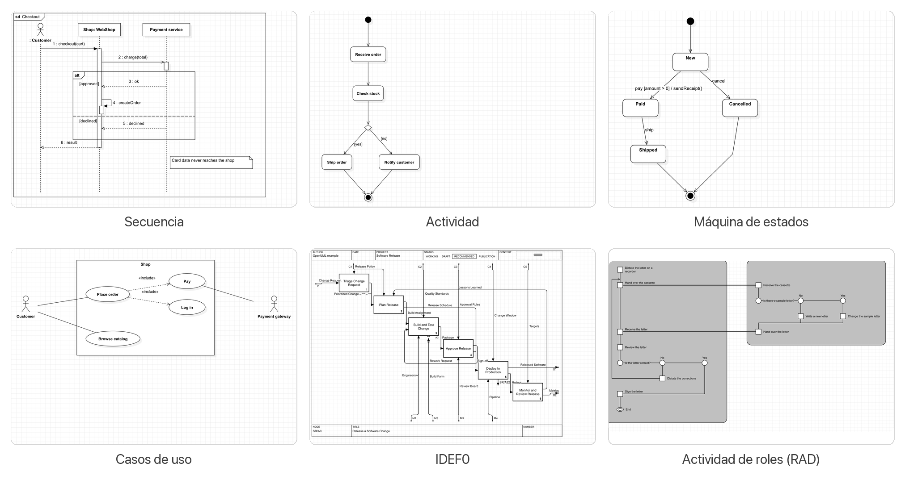

import { Card, CardGrid } from '@astrojs/starlight/components'
import AppShot from '../../../components/AppShot.astro'
import SystemDownloads from '../../../components/SystemDownloads.astro'
import YouTube from '../../../components/YouTube.astro'
import { VIDEOS } from '../../../videos'

<AppShot alt="OpenUML con un diagrama de clases abierto" />

## Qué puedes dibujar

<CardGrid>
  <Card title="Estructura UML" icon="seti:folder">
    Diagramas de clases, objetos, paquetes, componentes, despliegue, estructura compuesta y perfiles.
  </Card>
  <Card title="Comportamiento UML" icon="random">
    Casos de uso, actividad, máquina de estados, secuencia, comunicación, tiempos, vista general de interacción y flujo de información.
  </Card>
  <Card title="IDEF0" icon="puzzle">
    Numeración automática, flechas ICOM, descomposición en diagramas hijos, el diagrama de contexto A-0 y avisos de consistencia.
  </Card>
  <Card title="Diagramas de actividad de roles" icon="seti:pipeline">
    Roles, actividades, interacciones entre roles, refinamientos de caso y de parte, esperas y marcadores de estado.
  </Card>
</CardGrid>

## Hecho para modelar a diario

<CardGrid>
  <Card title="Tus archivos, formato abierto" icon="document">
    Los modelos son archivos `.mdj`: JSON que es tuyo y que también abren otras herramientas que leen `.mdj`.
  </Card>
  <Card title="Edición segura" icon="approve-check">
    Deshacer y rehacer para cada cambio, autoguardado cada minuto y recuperación tras un cierre inesperado.
  </Card>
  <Card title="Compártelo" icon="external">
    Exporta a PNG, SVG y PDF, o a un sitio web interactivo sin conexión que cualquiera puede recorrer.
  </Card>
  <Card title="A tu manera" icon="setting">
    Temas claro y oscuro, barra de herramientas compacta, paneles reorganizables, paleta de comandos y atajos personalizados.
  </Card>
</CardGrid>

## Consigue OpenUML

Gratis y de código abierto con licencia MIT. Sin cuenta ni telemetría: la única conexión automática es la búsqueda de actualizaciones, que puedes desactivar.

<SystemDownloads lang="es" />

O [úsalo en el navegador](/app/), sin instalar nada: tus archivos se quedan en tu equipo. [Cómo funciona](/es/docs/browser/).

## Navegación básica

Un recorrido breve en video por la ventana de OpenUML. Más videos en [Tutoriales](/es/docs/tutorials/).

<YouTube id={VIDEOS.basicNavigation} title="OpenUML basic navigation tutorial" />
