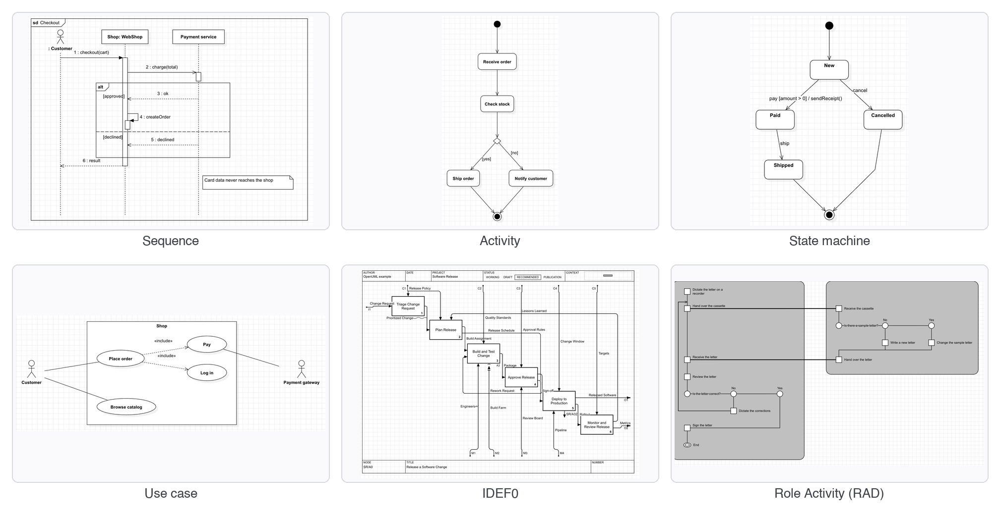

import { Card, CardGrid } from '@astrojs/starlight/components'
import DownloadButton from '../../components/DownloadButton.astro'

## What you can draw

<CardGrid>
  <Card title="UML structure" icon="seti:folder">
    Class, object, package, component, deployment, composite structure and profile diagrams.
  </Card>
  <Card title="UML behavior" icon="random">
    Use case, activity, state machine, sequence, communication, timing, interaction overview and information flow.
  </Card>
  <Card title="IDEF0" icon="puzzle">
    Automatic numbering, ICOM arrows, decomposition into child diagrams, the A-0 context diagram and consistency warnings.
  </Card>
  <Card title="Role Activity Diagrams" icon="seti:pipeline">
    Roles, activities, interactions between roles, case and part refinements, waits and state markers.
  </Card>
</CardGrid>

## Built for everyday modeling

<CardGrid>
  <Card title="Your files, open format" icon="document">
    Models are `.mdj` files: plain JSON you own, that other tools that read `.mdj` can open too.
  </Card>
  <Card title="Safe editing" icon="approve-check">
    Undo and redo for every change, autosave every minute and recovery after a crash.
  </Card>
  <Card title="Share it" icon="external">
    Export to PNG, SVG and PDF, or to an offline interactive website that anyone can browse.
  </Card>
  <Card title="Your way" icon="setting">
    Light and dark themes, a compact toolbar, panels you can rearrange, a command palette and custom shortcuts.
  </Card>
</CardGrid>

## Get OpenUML

Free and open source under the MIT license. No account, no telemetry: the only automatic connection is the update check, which you can turn off.

<DownloadButton />
